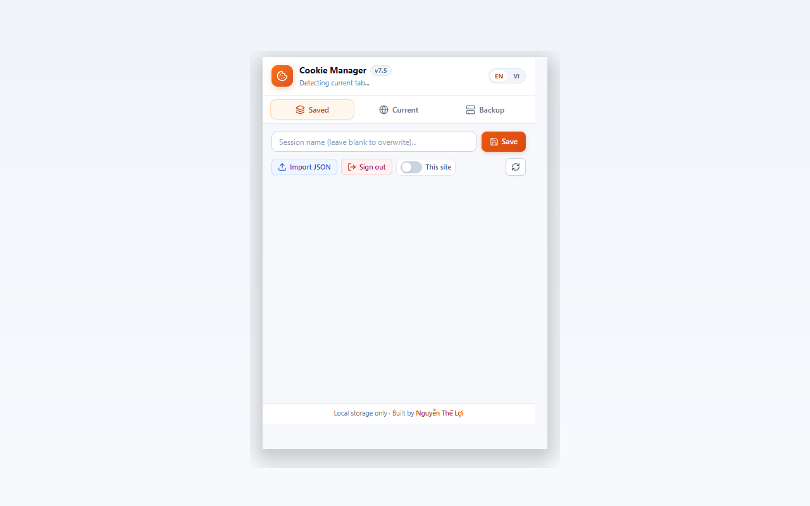

# 🍪 Cookie Manager

<p align="center">
  
</p>

<p align="center">
  <b>A lightweight, secure, and offline cookie and session manager for Chromium browsers.</b><br>
  <i>Chrome Extension · Manifest V3 · Version 7.5 · 100% Offline & Private</i>
</p>

<p align="center">
  
  
  
  
  
</p>

---

<p align="center">
  
</p>

---

## ✨ Features / Tính năng nổi bật

### 🌐 100% Offline & Local-First (Bảo mật tối đa)
- **Zero Cloud / No Remote Calls**: Không gửi bất kỳ dữ liệu cookie hay thông tin duyệt web nào ra máy chủ bên ngoài.
- Tuân thủ hoàn toàn chính sách bảo mật của **Chrome Web Store (CWS)**.

### 📋 Live Cookie Inspection & Fast Export (Quản lý thời gian thực)
- Hiển thị danh sách cookie của trang hiện tại với trạng thái `Secure`, `HttpOnly`, `SameSite`.
- **One-Click Header Copy**: Nút copy cạnh chip tên miền tự động định dạng toàn bộ cookie dưới dạng chuỗi chuẩn `name=value; ...` để dùng ngay trong curl, postman hoặc script.
- Tìm kiếm nhanh cookie theo tên, giá trị hoặc domain.
- Xoá hoặc chỉnh sửa từng cookie; Đăng xuất nhanh (One-click logout) bằng cách xoá sạch cookie phiên của trang hiện tại.

### 🔒 Client-Side Encrypted Backups (Sao lưu mã hóa AES-256)
- Lưu danh sách cookie thành các hồ sơ (**Snapshot**) theo từng website.
- Sao lưu toàn bộ cấu hình ra tệp dự phòng được mã hóa an toàn bằng thuật toán **AES-256** với mật khẩu bảo vệ của riêng bạn.
- Khôi phục (Restore) tức thì chỉ bằng một cú click.

### 🌏 Bilingual Interface (Giao diện song ngữ thông minh)
- Ngôn ngữ mặc định là **tiếng Anh (EN)**, có nút chuyển đổi tức thì sang **tiếng Việt (VI)** trên thanh tiêu đề.
- Đồng bộ thông báo, nhãn và mô tả chi tiết theo ngôn ngữ được chọn.

### 🎨 Modern Light UI
- Thiết kế hiện đại, tinh gọn theo phong cách Light theme sạch sẽ, thẻ trực quan, bố cục rõ ràng và tối ưu kích thước popup 430px.

---

## 📂 Project Structure / Cấu trúc thư mục

```
cookie-manager-autosave/
├── _locales/
│   ├── en/messages.json             # Bản dịch tiếng Anh (Mặc định)
│   └── vi/messages.json             # Bản dịch tiếng Việt
├── assets/
│   └── style.css                    # Toàn bộ kiểu dáng giao diện Light UI
├── icons/
│   ├── logo-16.png                  # Biểu tượng 16x16
│   ├── logo-32.png                  # Biểu tượng 32x32
│   ├── logo-48.png                  # Biểu tượng 48x48
│   └── logo-128.png                 # Biểu tượng 128x128
├── background.js                    # Service Worker xử lý cookie, storage & i18n
├── manifest.json                    # Khai báo tiện ích Manifest V3
├── popup.html                       # Giao diện chính của Extension
├── popup.js                         # Logic điều khiển, mã hóa AES-256, UI & sự kiện
├── cookie-manager-autosave.zip      # Gói nén tiện ích sẵn sàng tải lên Store
└── screenshot-1280x800.png          # Ảnh chụp màn hình chuẩn 1280x800
```

---

## 🚀 Installation / Cài đặt

### Cách 1: Cài đặt từ mã nguồn (Developer Mode)

1. Tải về hoặc clone repository này:
   ```bash
   git clone https://github.com/lowji194/Extension-Cookie-Manager.git
   ```
2. Mở trình duyệt Google Chrome / Microsoft Edge / Brave.
3. Truy cập đường dẫn: `chrome://extensions/`
4. Bật chế độ dành cho nhà phát triển (**Developer mode**) ở góc trên bên phải.
5. Nhấn **Load unpacked** (Tải tiện ích đã giải nén) và chọn thư mục `cookie-manager-autosave`.
6. Ghim biểu tượng **Cookie Manager** lên thanh tiện ích và sử dụng!

### Cách 2: Sử dụng gói đóng gói sẵn (.zip)

1. Tải tệp `cookie-manager-autosave.zip` từ repository.
2. Giải nén vào một thư mục trên máy tính.
3. Thực hiện các bước cài đặt `Load unpacked` như trên.

---

## 🛡️ Quyền hạn & Bảo mật (Permissions)

Tiện ích chỉ yêu cầu các quyền hạn tối thiểu phục vụ đúng mục đích:
- `cookies`: Đọc và cập nhật cookie cho website đang thao tác theo yêu cầu người dùng.
- `storage`: Lưu trữ các bản snapshot và tệp sao lưu mã hóa cục bộ trong trình duyệt.
- `activeTab`: Nhận diện tên miền của tab đang mở khi nhấn vào extension.
- `<all_urls>`: Cho phép người dùng quản lý cookie trên các trang web mình truy cập.

---

## 👨‍💻 Tác giả / Author

- **Nguyễn Thế Lợi** ([@lowji194](https://github.com/lowji194))
- **Website:** [lowji194.github.io](https://lowji194.github.io)
- **Facebook:** [Lowji194](https://facebook.com/Lowji194)

---

## 📄 Giấy phép / License

Dự án được phát hành theo giấy phép **MIT License**.
